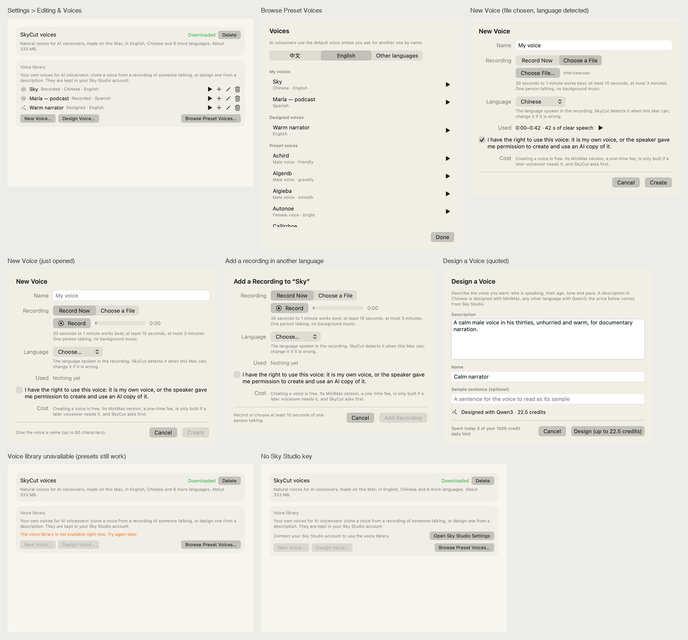
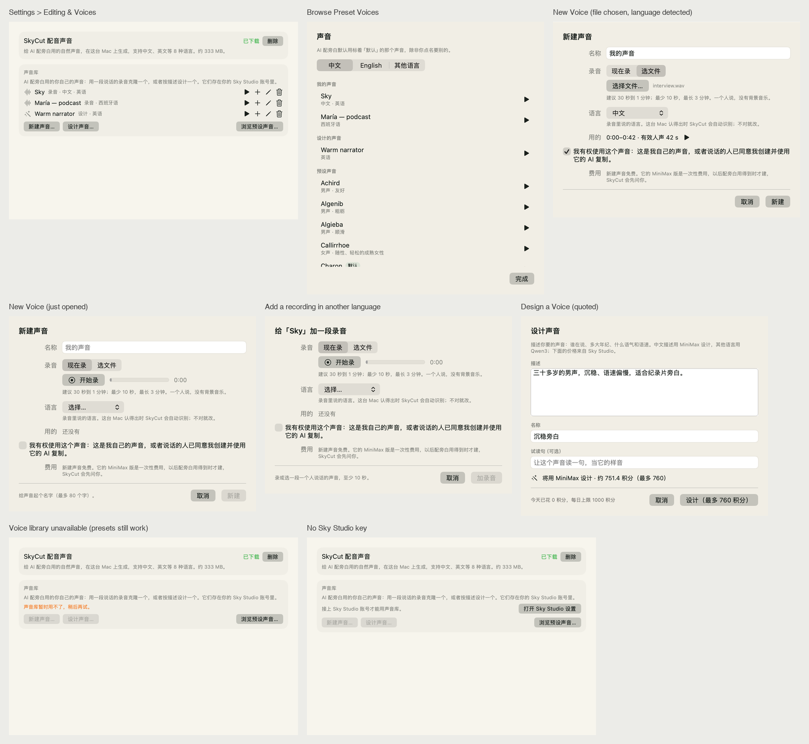
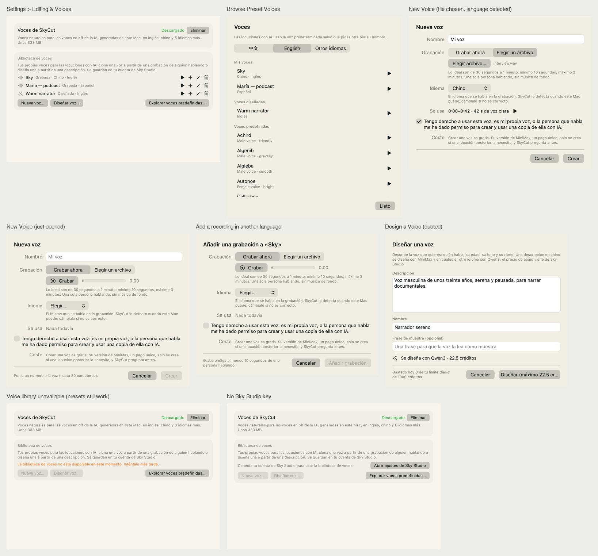

# 声音库界面的离屏渲染（声音 PR 8，2026-11-10）

> 做了什么、规矩和守卫在 [声音库](../architecture/voice-library.md)第九节；方案是 [SkyCut 声音方案](../plans/2026-11-09-voice-features.md) 5.1–5.4。
> 这里只记这一次看图的证据和没验到的。

## 怎么出的图

`scripts/render-voice-library.sh <输出目录>`：链接完整 App 的目标文件，把**生产的视图**放进一个真窗口（主屏左下角、所有窗口最底下，不抢前台），
数据来自假 Sky Studio（`checks/VoiceRecovery/LibraryFixture.swift` 的 `VoiceLibraryHTTP`：Sky Studio 导出的目录快照、`/voices`、`/quote`），
英 / 中 / 西三种界面语言各出 8 张，再拼成一张。不碰网络、钥匙串、麦克风，不花钱，不动用户的 SkyCut。系统是深色模式、主题是森林色（固定浅色）。

每张拼图里的 8 格：设置 → 剪辑与声音里声音的那两节（三个声音：录音的两个、设计的一个）、浏览预设声音、新建声音（选了文件、语言检测出来、勾了授权）、
新建声音（刚打开）、给声音加一段录音、设计声音（报价回来了）、声音库暂时用不了、没接 Sky Studio。

| 界面语言 | 图 |
| --- | --- |
| English |  |
| 简体中文 |  |
| Español |  |

## 看到的

- 三种语言都没有截字、漏翻；西语最长的几处（「Explorar voces predefinidas…」、授权那一句折成两行、设计的说明三行）都放得下。
- 中文描述的设计报价显示「将用 MiniMax 设计 · 约 751.4 积分（最多 760）」，按钮「设计（最多 760 积分）」；英文、西语的描述是 Qwen3、只有一个数（22.5）。
  数来自假服务照目录快照的价目回的，界面不写死。
- 声音库用不了时新建 / 设计灰着、「浏览预设声音…」照样能点；没接 Sky Studio 时给「打开 Sky Studio 设置」。
- 第一版看图撞出两件事：`"Language"` 这个键在中文表里是「界面语言」，录音的语言不能共用它（换成专用的键）；渲整个设置窗口会把这台 Mac 上用户自己的
  剪辑风格名拍进去（脚本改成只摆声音的那两节）。

## 没验到的（自动化够不着，在[声音库](../architecture/voice-library.md)第九节的人工回归里）

- 真麦克风：系统的授权框、电平条、录到 3 分钟自己停、被拒之后的那一句。
- 真 Sky Studio：声音接口上线之后的新建、加录音、改名、删除、设计（设计要花积分，先请用户批准预算）、试听临时链接。
- 真窗口里的 sheet：这里的图是自建窗口里的同一个视图，sheet 的出场、键盘焦点、默认按钮、删除确认框要在真 App 里看。
- 本机语言检测：渲染里是给定的结果（「中文」），真检测要 macOS 26 和装好的转写模型。
