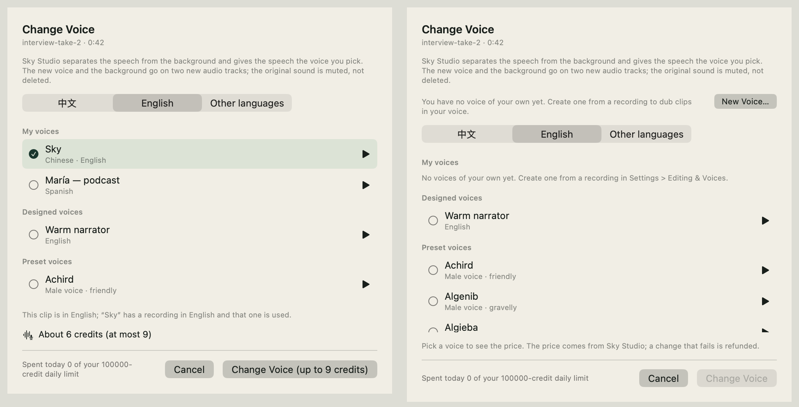
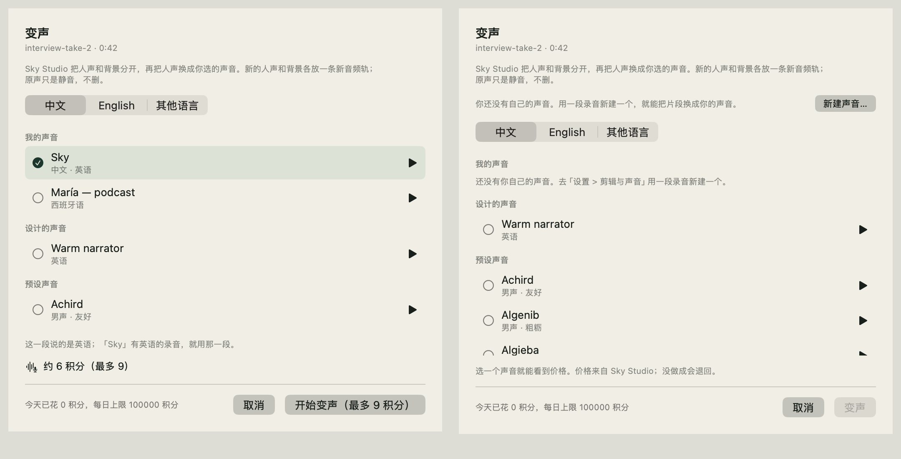
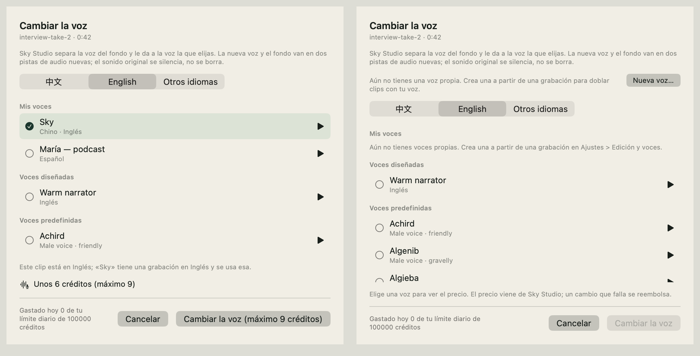

# 变声（声音 PR 9）：离屏渲染和免费冒烟（2026-11-11）

> 做了什么、规矩和守卫在 [声音库](../architecture/voice-library.md)第十节；方案是 [SkyCut 声音方案](../plans/2026-11-09-voice-features.md) 4.8、4.9、5.5。
> 这里只记这一次的证据和没验到的。**没有对真 Sky Studio 跑过**（变声要花积分；留在人工回归里，先请用户批准预算）。

## 一、变声面板的离屏渲染

`scripts/render-voice-library.sh <输出目录>` 的第 9、10 张：生产的 `VoiceChangePanel` + 面板背后的 `VoiceChangePanelModel`，数据来自假 Sky Studio
（`checks/VoiceRecovery/VoiceChangeFixture.swift` 的 `VoiceChangeHTTP`：Sky Studio 导出的目录快照、`/voices`、变声的 `/quote`），时间线上是一段 42 秒的
音频段（现写的 WAV，面板真的把它截成单声道 WAV、量过响度）。英 / 中 / 西各两张，拼成一张：左边是有自己的声音（默认选中上次用过的 Sky、
检测出这段说的是英语、报价回来了），右边是还没有自己的声音（顶上「新建声音…」、什么都没选、按钮灰着）。

| 界面语言 | 图 |
| --- | --- |
| English |  |
| 简体中文 |  |
| Español |  |

看到的：

- 三种语言都没有漏翻；「约 6 积分（最多 9）」、按钮「开始变声（最多 9 积分）」的数来自假服务的报价，界面不写死。
- **第一版英文和西语的按钮被截成「Change Voice (up to 9 cre…」**：底栏左边那句「今天已花…」和两个按钮抢宽度，按钮被压缩了。改成两个按钮
  `.fixedSize()`、左边那一句折行（图是改完之后的）。
- 预设在中文那一排显示中文的说明（「男声 · 友好」），英文、西语界面显示英文的（和声音库的选择器同一份）。
- 右图里「还没有自己的声音」说了两遍（面板顶上一句带「新建声音…」的，选择器「我的声音」一组空着时自己的一句）：选择器那句是共用组件的，没有另改。

## 二、真 App + 真 MCP + 本机假 Sky Studio 的冒烟

`scripts/gui-smoke/sky-studio/run.sh` 起独立的测试 App（自己的 bundle id、假 Key、`SRTFLOW_SKYSTUDIO_API_BASE` 指到回环地址），
`scripts/gui-smoke/sky-studio/voice_change.py` 经包里的 `skycut-mcp` 调工具（后台模式，不开窗口）。假服务把传上去的那段源音频原样当成
「变声后的人声」和「背景」回来。2026-11-11 在这台 M1 上跑通：

| 步骤 | 结果 |
| --- | --- |
| `add_clips` 一段 17.1 秒的 `voice-sample.wav` | A1 上一段 |
| `change_voice clip_id=… voice=voice_555… language=en` | `status: started`、种类 `voice_change`、`credits: 3`、`credits_expected: 2`、`target_language: en` |
| `get_job` 等到做完 | `done`、`model: chatterbox-hd`、`credits_charged: 2`、`voice_track: A2`、`background_track: A3` |
| `get_timeline` | 三条音频轨各一段；原段 `muted: true`；两段新音频和原段同一个起点、终点差不到 0.05 秒 |
| 文件 | `voice-sample - Smoke voice.wav`、`voice-sample - background.wav`，都在源文件旁边、单声道 |
| `undo` | 回到一条音频轨、原段没静音；今天已花不变（撤销不退钱） |
| 假服务的日志 | 先 `/quote`（`voice_convert`、`model: auto`、按源秒数）→ `/uploads`（`voice_convert_source`、`audio/wav`）→ PUT（不带 Key）→ **一次** `/jobs`（`max_credits: 3`）；传上去的是单声道 16-bit、长度正好是这一段 |
| `change_voice voice=eleven:Daniel` | 收费之前拒（叫它看 `list_voices`），没有新的 `/jobs` |

## 三、没验到的（在[声音库](../architecture/voice-library.md)第十节的人工回归里）

- **真 Sky Studio**：声音像不像、口型对不对、接近 5 分钟的片段、立体声背景变单声道、预设当目标、`target_language` 真起作用（要花积分）。
- **真窗口**：右键菜单项、sheet 的出场和键盘焦点、云端任务浮层里那一行、提示条、「新建声音…」从面板里弹出来。
- **本机语言检测**：渲染和回归里是给定的结果；真检测要 macOS 26 和装好的转写模型。
- **预览性能 ratchet**：`VoiceChangePresenter` 和 `UpscalePresenter` 同样挂在检查器底下、`.equatable()`，本机没法跑那一步（CI 独有），看 CI。
