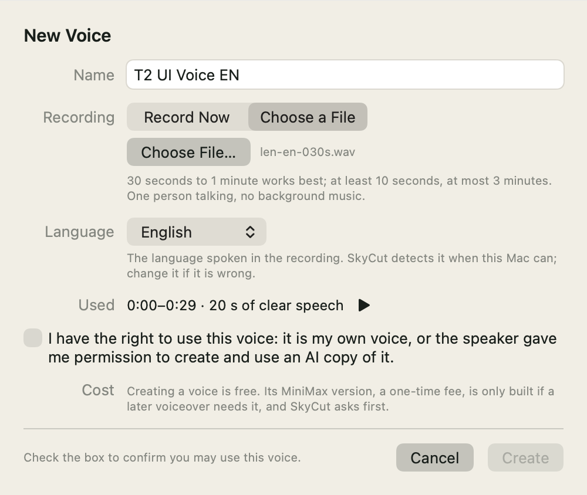
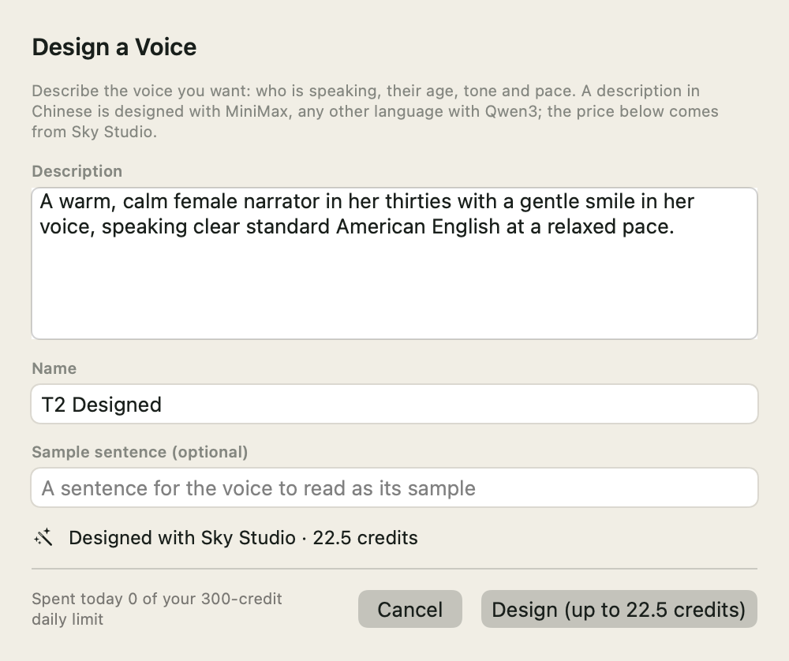
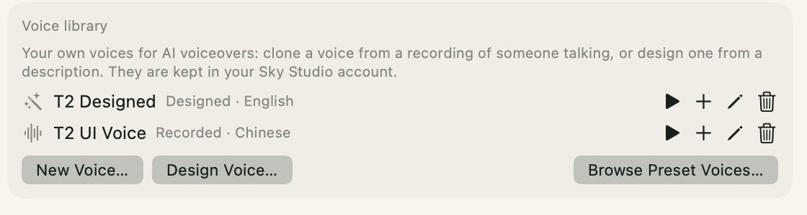
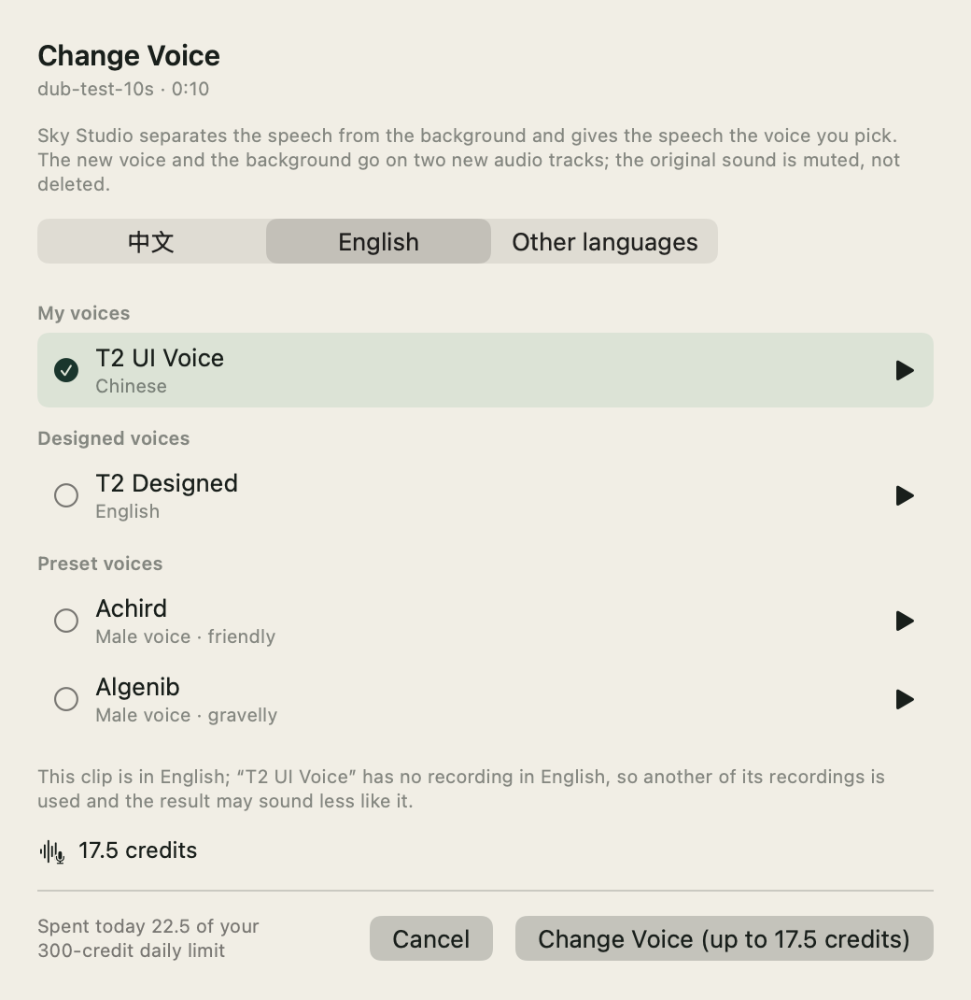
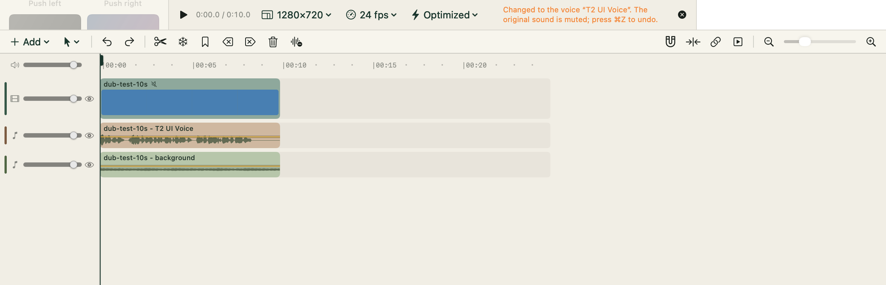
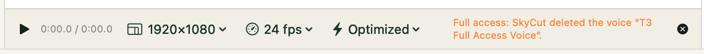

# 声音功能的真实冒烟：界面那一半 + AI 工具那一半（2026-11-11）

> 用户 2026-11-11 01:05 授权真实冒烟、总预算 USD 10（原价），协调者照 `impl-briefs/T2-real-smoke.md` 派的活。**两半一共花了 74.2 积分（USD 0.30）**。
> 范围中途改过：测试账号是 SkyCut 免费套餐，AI 工具全被照授权拦下；改生产库里账号的套餐被安全规则挡住、要等用户早上点头，所以夜里只走
> **App 里的界面**（进程内 GUI 冒烟驱动隔离测试 App，第一到七节，40 积分），只能经 AI 工具的那几项记成「等用户开 AI 开关」，没有绕。
> 早上用户点头、协调者开了测试账号的 AI 开关，经 AI 工具的那几项补在**第八节**（`impl-briefs/T3-ai-smoke.md`，34.2 积分）。

## 一、怎么测的

- **隔离测试 App**：bundle id `com.srtflow.SrtFlow.t2real.skystudiosmoke`，从 main（fb49bf5：声音 PR 3–9、App Nap #371、声音库审查 #375）加本 PR 的冒烟步骤打的。
  没碰正式版、测试版、用户的钥匙串和工程；步骤表、结果、截图、素材全在 `/private/tmp`，跑完删了。
- **真 Sky Studio + 测试账号**：TestTeam 成员 `E2E_TEAM_MEMBER`，SkyCut 免费套餐（`features.mcp: false`），起手余额 1,182.3。临时 Key 照 V 的 `--login` 那一套建：
  只放进测试 App 的进程环境，App 拿真的 `/me` 验过再存进它**自己的**钥匙串条目；冒烟 App 的 Key 钩子只认回环地址，所以 App 连本机一个只转发的小进程
  （原样转给 Sky Studio 的 `/api/skycut`，走系统代理；日志只记方法、路径、状态和对账要用的正文，不记任何头、网址去掉签名参数）。脚手架在仓库外的
  `SkyVoiceForClone/skycut-real-smoke/`（建 / 撤 Key、转发、打包、跑步骤表、记账、只读对账）。
- **怎么点界面**：[GUI 冒烟流程](../testing/gui-smoke-testing.md)「四之六」的进程内驱动，加了 `voice` 一步（第 19 条）：按钮背后是 NSButton、输入框要 key 窗口、
  「选择文件…」是系统面板，这几样由 `voice` 让那一节 / 那张 sheet 调按钮自己调的那个函数、往 sheet 自己的模型里填字；变声面板走片段右键那个入口。
  截图是 App 自己画的（这个终端没有录屏权限，第 21 条）。
- **每一单之前**记一行「已花 + 这次最坏」（上限 2,500 积分），测试 App 自己的每日额度设成 300 积分兜底；钱对三处：SkyCut 记的、Sky Studio 的任务行和余额、
  fal 的 billing-events（按 request_id）。

**免费套餐只关 AI 工具（先确认的那一条）**：代码里套餐只在两处判 —— `AIToolRouter` 里 AI 的调用（`SkyStudioAccount.aiRefusal`）和导出水印；声音库、设计、
变声的界面不看套餐，Sky Studio 的合同也写着「每个套餐都能花积分」。实测免费套餐下声音库照常取到、建 / 设计 / 变声 / 删都成了（下面）。

## 二、逐项结果

| # | 项目 | 跑了没有 | 结果 |
| --- | --- | --- | --- |
| 1 | 设置 → 剪辑与声音 → 新建声音（授权那一勾） | 跑了两次 | ✅ 选文件后参考录音和语言自动出来（中文 29.95 秒、有效人声 22.98 秒；英文 29.08 秒、20.50 秒，语言各自认对）；没勾授权时「新建」灰着、写「勾上那一句确认你能用这个声音」；勾上就亮。按下：`/uploads`（`voice_reference`、`audio/wav`）→ PUT → **一次** `POST /voices` 201，带 `consent: true`、`consent_statement_version: voice-consent-v1`、语言、用了哪一段、文件名、`idempotency_key`；新声音马上出现在列表里 |
| 2 | 设计声音一次（Qwen3 短描述） | 跑了 | ✅ 报价 22.5（`exact`；服务器按英文描述选 `qwen3-voice-design`，备用 MiniMax 752.8 不自动换）；按「设计」**一次** `POST /jobs`（`max_credits` 22.5）→ 25 秒做完、有样音，列表里出现「Designed · English」。⚠️ 报价那一行写成「Designed with Sky Studio · 22.5 credits」，没写 Qwen3 → 另开 PR #379 修（`docs/bugfixes/2026-11-11-design-quote-model-name.md`） |
| 3 | 删声音 | 跑了三次 | ✅ 点垃圾桶弹「删除『X』？」、按删除 → `DELETE /voices/{id}` 200，立刻从列表消失；跑完库里这个账号 0 个声音、0 段参考录音、0 个有效的长期授权 |
| 4 | 片段右键「换成我的声音」10 秒 | 跑了 | ✅ 见下一节 |
| 5 | `add_voiceover` 多批、繁体、长句 | 夜里没跑；早上跑了 | 只能经 AI 工具，开了 AI 开关之后跑的：✅ 见第八节 |
| 6 | 全部权限的长期授权（声音 PR 7） | 夜里没跑；早上跑了 | 是 AI 权限模式的事、效果要经 AI 工具看：✅ 见第八节（回答里有一处说反，修在 #383） |
| 7 | 不在前台时不降速（#371） | 早上量了 | 夜里是界面起的任务、测试 App 的窗口一直开着，没造出 App Nap 的条件；早上藏着测试 App 量了三单旁白：✅ 见第八节 |

### 变声（第 4 项）

- 素材：一段 10.00 秒的视频放在 V1（`dub-test-10s.mp4`：macOS 的 Samantha 读一句英文 + 合成的和弦铺底，单独做的，不是谁的声音）。
- 面板：默认选中「我的声音」里唯一那个（第 1 项建的中文声音），检测出这段说的是英语，写了一句「这段是英语，这个声音没有英语的录音，用它别的录音、可能没那么像」；
  报价 17.5（`exact`），按钮「Change Voice (up to 17.5 credits)」。
- 按「开始」：`/uploads`（`voice_convert_source`，960,044 字节 = 10 秒单声道 WAV）→ **一次** `POST /jobs`（`max_credits` 17.5）→ 81 秒做完，`chatterbox-hd`，`fallback_used: false`。
- 落地：**两条新音频轨**（A1 新的人声、A2 背景），两段都在 0.000–10.000，**和原段一样长**；**原段静音、没删**；三段在同一个链接组；提示条
  「Changed to the voice “T2 UI Voice”. The original sound is muted; press ⌘Z to undo.」。
- 两个文件都是 10.00 秒（48 kHz 单声道）：新的人声平均 −16.7 dB（原来的人声 −16.4 dB）、峰值 −0.1 dBFS；背景平均 −27.6 dB（原来的铺底 −24.4 dB）。
- **一步撤销**：撤一下回到只有 V1 一段、没静音、没有音频轨。
- 像不像没人听（夜里没有耳朵）；文件是用户声音克隆出来的，跑完删了。

## 三、每一单的实收

| 单 | Sky Studio 任务 | 报价 | SkyCut 记的 | Sky Studio 扣的 | fal 实收（billing-events，按 request_id） |
| --- | --- | --- | --- | --- | --- |
| 设计（Qwen3） | `069a06fc…`，`qwen3-voice-design`，done | 22.5 | 22.5 | 22.5，没有退款 | USD 0.09（1 个千字，和预期一样） |
| 变声（10 秒） | `18860935…`，`chatterbox-hd`，done | 17.5 | 17.5 | 17.5，没有退款 | 分离 USD 0.05（1 块）+ 变声 USD 0.02（1 分钟），和预期一样 |

- **合计 40 积分 = USD 0.16（原价）**；测试账号余额 1,182.3 → 1,142.3，正好少 40。新建 ×2、删除 ×3、几次报价不花钱。
- 这次没有 Gemini 的调用（没配旁白），Vertex 那边没有要对的。

## 四、Key 和清理

- 一共建过 8 把临时 Key（`E2E_TEAM_MEMBER` 6 把；第 6 对 2 把，只问了一次 `/me` 看套餐），全部撤销、从 `keys.list` 读回来是 `revoked`，测试账号现在 0 把有效的。
  每把只活了 0.4–18.5 分钟（每重打一次测试 App，新的签名读不到旧的钥匙串条目，就换一把）。
- 测试建的 3 个声音都删了（库里 0 个声音、0 段参考录音、0 个有效授权）。
- 测试 App 的钥匙串条目、偏好、支持文件夹删了；`/private/tmp` 里的素材（用户录音的拷贝）、变声出来的文件、截图原件、fal 的对账导出（里面有别人的行）都删了。

## 五、发现

1. **SkyCut：设计的报价说不出用哪家**（第 2 项）。声音的报价顶层没有 `model`，用哪个只在 `voice_plan.selection.model`，SkyCut 只读顶层；两份假服务都补了顶层的
   `model`，回归和 PR 8 的离屏渲染一直是绿的。修在 #379（`docs/bugfixes/2026-11-11-design-quote-model-name.md`，带反向验证），免费冒烟的假服务一起改成真回答的形状。
2. **冒烟本身的三个坑**（写进了 [GUI 冒烟流程](../testing/gui-smoke-testing.md)第 20–22 条）：步骤表放在「下载」底下，新签名的测试 App 读它就卡在等授权；
   终端没有录屏权限时截图一张等 15 秒、全失败（改成 App 自己画）；后台起的 App 里 sheet 收起之后 `onDisappear` 不一定跑（判收没收起看窗口挂不挂着 sheet）。
   最后这条在产品里的影响很小：新建声音的对话框在 `onDisappear` 里删临时的参考录音，没删的会在下次启动时被清掉一天以前的那一批。
3. 没有发现 Sky Studio 的问题：报价、任务、扣费、退款、删除、授权记录都和合同、和 fal 的账单对得上。

## 六、没测的

- ~~等用户开测试账号的 AI 开关~~：早上开了，`add_voiceover` 多批 / 繁体 / 长句、全部权限的长期授权、App Nap 都跑了，见第八节。
- Qwen3 用 1,100 字左右的描述核「每开始 1,000 字」计价（45 积分）：协调者定只设计一次短描述，没做。
- 长句两半采样率不一样时的转换、Gemini 中途换 Eleven 的备用：这次两半都是 Gemini 24 kHz，没撞上，没硬造。
- 要人听的：变声出来的声音像不像、口型对不对；克隆读的旁白像不像；长句接缝那里听不听得出（两半电平差 1.6 dB，见第八节）。

## 七、截图（App 自己画的）

| 新建声音，还没勾授权（「新建」灰着） | 设计声音的报价（修之前写成 Sky Studio） |
| --- | --- |
|  |  |

| 声音库（建好、设计好之后） | 变声面板 |
| --- | --- |
|  |  |

变声落地之后的时间线（原段静音、两条新轨、提示条；预览是黑的，因为 App 自己画不出播放器的图层）：

## 八、AI 工具那一半（2026-11-11 上午）

> 用户早上（北京时间约 09:10）说「2: you can turn on AI tools for the test account」，协调者 09:14 把测试账号 `skycut_entitlements.feature_overrides`
> 从 `{"mcp": null, "watermark": null}` 改成 `{"mcp": true, "watermark": null}`（照管理后台的写法；**跑完由协调者把 `mcp` 改回 `null`**），照 `impl-briefs/T3-ai-smoke.md` 跑经 AI 工具的那几项。
> **花了 34.2 积分（USD 0.14）**；两半加起来 74.2 积分（USD 0.30），上限 USD 10。

### 怎么测的

- **测试 App**：同一个隔离身份（`com.srtflow.SrtFlow.t2real.skystudiosmoke`），从 main `dfe6f7c`（含 #379–#381）打的；1 把新的临时 Key，照旧只在测试 App 自己的钥匙串条目里。
  先确认放行了：`get_status` 的 `skycut_plan.ai_tools: true`（套餐照旧是 `free`、照旧带水印），`list_voices` 不再被拒。
- **扮成 AI 客户端**：起 App 包里的 `skycut-mcp`，照真会话的样子调工具（问句照问、`confirm_token` 再调）；脚手架在仓库外的 `SkyVoiceForClone/skycut-real-smoke/`（`t3.py`）。
  请求批准模式、测试 App 自己的每日额度设成 300 积分兜底；每单之前照旧记「已花 + 这次最坏」。
- **App Nap**：测试 App 用 `open -j` 藏着开（闲着 20 秒后 `ps -o pri` 掉到 4，这是对照）；每单旁白起来之后 25 秒、做完关掉工程之后 35 秒都不发 MCP 调用
  （一次工具调用自己就领着不降速的那一份），这两段里每 0.25 秒读一次优先级。
- **全部权限那一项**：测试 App 露着（`ui.sh`），进程内冒烟同时跑一份只读的步骤表：等着、读主窗口的提示条、自己画一张窗口，AI 那边做完删除才切回去。

### 逐项结果

| # | 项目 | 结果 |
| --- | --- | --- |
| 1 | 用库里的声音读稿，多批 | ✅ `manage_voices` 建声音时没给 `language`：识别成中文、问句里带 `voice-consent-v1` 那一句和「识别成中文」，带 `confirm_token` 再调才建。`add_voiceover voice=voice_…`、四句中英混合（334 字）：服务器按 `zh_80`（中文占读的时间 ≥ 80%）选 **IndexTTS2**，MiniMax 版要一次性费用（376.4）只列在备用里、**没问也没建**；按中文 300 字的上限分 **2 批**（前三句 264 字 + 第四句 70 字）同时交；本机转写切句、没有按字数估的句子；**字幕 25 条，去掉标点后和稿子一字不差**（286 字），每句第一条字幕比实测开口（按 −40 dBFS 量，可能是换气）早 0.25 秒到晚 0.25 秒；报价 26.5（按秒结算，是估的）→ 实扣 25.5 |
| 2 | 繁体中文旁白 | ✅ 四句繁体（114 字）**合成 1 批**，预设 `gemini:Charon` / Gemini 3.8 Flash TTS；切句成了、**没有 `local_split`**、也没有按字数估；**转写出来的字是繁体**（「歡迎收看本集節目……匯入時間線……背景音樂」）= 用的是 zh_TW 的模型（`zh-Hant`）；字幕 11 条 = 稿子的字，每句第一条比开口早 0–0.24 秒；2.6 积分 = 报价 |
| 3 | 长句跨两批 | ✅ 一句 967 字的英文（上限 800）拆成 **2 批**：42.64 秒 + 10.32 秒，两批都是 Gemini、**都是 24 kHz**（这次用不着换采样率），没撞上 Gemini → Eleven 的备用（没硬造）。接起来一个 53.08 秒的文件：接缝上是 0.27 秒的自然停顿，接缝前后 5 毫秒里相邻采样最大只差 0.0004（全文件的 99.9 分位是 0.25）—— **没有爆音、没有断开**；两半说话的电平差 1.6 dB（两批的原始音频各自峰值 −1 dBFS，接缝前后 5 秒差 3.2 dB，后半起头是新的一句），**要人听一下**。字幕 29 条 = 稿子；6.1 积分（报价 7.2，按实际 token 结算） |
| 4 | 全部权限的长期授权（声音 PR 7） | ✅ `set_settings ai_access_mode=full_access` 先问：问句列了不再先问的几件事、一次性费用（MiniMax 设计约 751.4、Qwen3 每开始 1,000 字 22.5、MiniMax 版约 377.6）、每日额度照旧是硬上限（300）、`voice-standing-consent-v1` 那一句；点头之后 Sky Studio **有效长期授权 0 → 1**（`recorded`）。用英文录音建声音**不问**（结果写 `consent: standing_grant`）；删掉**不问**，主窗口提示条「Full access: SkyCut deleted the voice “T3 Full Access Voice”.」（截图见下）。切回请求批准**照样问**，点头之后**撤掉、有效授权 1 → 0**（`revoked`）。⚠️ 回答里设置那一处说的是改之前的状态 → 修在 #383（见「发现」1） |
| 5 | App Nap（#371） | ✅ 三单旁白跑着、不发调用的那 24 秒：优先级全是 28（92 + 90 + 90 个采样，**没有一个是 4**）；第 2、3 单做完、关掉工程之后的 35 秒：全是 4（127 + 128 个）—— 任务一完就还掉了。第 1 单的「做完之后」量不出来：旁白落进了主窗口的工程，预览的音频引擎从那一刻起一直开着（见「发现」2） |

### 每一单的实收

| 单 | Sky Studio 任务 | 模型 | 预计 | 交的时候扣（预留） | 结算后退回 | 净扣 = SkyCut 记的 | 服务商实收 |
| --- | --- | --- | --- | --- | --- | --- | --- |
| 库里的声音 · 第 1 批 | `2d8ddf23…` | `index-tts-2` | 20.5 | 32.5 | 12.5 | **20** | fal USD 0.08（40 秒） |
| 库里的声音 · 第 2 批 | `fa25f32c…` | `index-tts-2` | 6 | 10.5 | 5 | **5.5** | fal USD 0.022（11 秒） |
| 繁体 | `6e953bbb…` | `gemini-3.8-flash-tts` | 2.6 | 6.3 | 3.7 | **2.6** | Vertex 输入 85 / 输出 565 token，USD 0.010255 |
| 长句 · 前半 | `9925bcca…` | `gemini-3.8-flash-tts` | 5.8 | 15.8 | 10.9 | **4.9** | Vertex 157 / 1,066 token，USD 0.019345 |
| 长句 · 后半 | `d06c34f2…` | `gemini-3.8-flash-tts` | 1.4 | 3.8 | 2.6 | **1.2** | Vertex 32 / 258 token，USD 0.004676 |

- **合计 34.2 积分 = USD 0.14（原价）**；测试账号余额 1,142.3 → 1,108.1，正好少 34.2。建声音 ×2、删除 ×2、几次报价、切权限不花钱。
- Sky Studio 的 `credits_charged` 记的是交的时候整笔扣的预留，结算后退回的在 `provider_meta.reservation_credits_returned`：净扣是两者之差（合同如此，`docs/agents/skycut-api.md`「Reservation and settlement」），
  和 SkyCut 记的、余额少的都对得上。
- fal `billing-events` 按 request_id 查：两条都和预期一样（差 0）。Vertex Monitoring（01:36–01:42 UTC）：3 个请求、全是 200，输入 274 / 输出 1,889 token，和 Sky Studio 记的一模一样。
- 两半加起来：**40 + 34.2 = 74.2 积分 = USD 0.30**（原价，上限 USD 10）。

### 发现

1. **SkyCut（已修，#383）：`set_settings` 回答里的长期授权说了两样**。先拍设置、再去 Sky Studio 记 / 撤：打开时顶层写 `recorded`、`sections.ai.voice_standing_consent`
   写 `unknown`；**切回请求批准时顶层写 `revoked`、设置那一处还写 `recorded`**。改成先记 / 撤再拍，`StandingChecks` 两处都查（`docs/bugfixes/2026-11-11-set-settings-stale-standing-consent.md`）。
2. **SkyCut（用户同日同意改，修在 [预览的音频引擎一直开着](../bugfixes/2026-11-11-preview-audio-engine-never-idles.md)）：主窗口的工程一旦有过声音，预览的音频引擎就一直开着**。停着也在渲静音（App 里一条优先级 97 的实时线程、约 0.6% CPU），
   coreaudiod 挂着 `PreventUserIdleSystemSleep`（`com.apple.audio.BuiltInSpeakerDevice.context.preventuseridlesleep`：**Mac 不会空闲睡眠**），App Nap 也不再生效；
   关掉那个工程、主窗口换成空的 Untitled 也一样（主窗口是同一个对象，`newProject()` 不停引擎），直到退出 App。证据：断言的起算时间正好是旁白落进主窗口那一刻，
   关工程之后还在、测试 App 一退出就没了。起点是 2026-10-01 音频引擎有意的设计（[音频引擎](../architecture/audio-engine.md)第二条：「暂停 = 锚点标成不播（出静音，图不停）」，第一次重建预览时起图），当时没量过它对睡眠和 App Nap 的影响。
   照代码看，用户自己的 SkyCut 只要主窗口里开过带声音的工程，就一直是这样。改法的建议：停着超过一段时间（比如 30 秒）停引擎、按播放时走 11-05 那条恢复路径再起（要量停过之后第一次播放多等多久）；
   主窗口换工程、没有声音时直接停。动的是用户定的「播放 / seek 无感」，所以先报、等拍板。
3. **SkyCut（观察）**：机器很忙（负载 8）时测试 App 重启后第一次静默读钥匙串超过 3 秒，AI 收到「要用户点 Allow…」，其实再调一次就好（迟到的结果已经缓存了）。
   这是 11-07 的设计（`KeychainSecretCache`）；给 AI 的话可以加一句「先再试一次」，没改。
4. **Sky Studio（小，供参考）**：第 1 项的报价把稿子里几个英文界面词（Settings、Voice Library、New Voice）算成了罗马尼亚语（`voice_plan.languages` 里 `ro` 2.2 秒、4.2%），
   不影响选模型（`zh_80`）。

### Key 和清理

- 1 把临时 Key（`b6d2a25e…`）用完撤销、读回来 `revoked`；测试账号现在 0 把有效的。
- 测试建的 2 个声音都删了：库里 0 个声音、0 段参考录音、0 个有效的长期授权。
- 测试 App 的钥匙串条目、偏好、支持文件夹，`/private/tmp` 里的录音拷贝、克隆出来的旁白、工程和截图原件都删了；fal 的对账导出（里面有别人的行）看完就删了。
- **测试账号的 AI 开关请协调者改回 `null`。**

全部权限下删声音之后的提示条（App 自己画的，裁了一条）：

